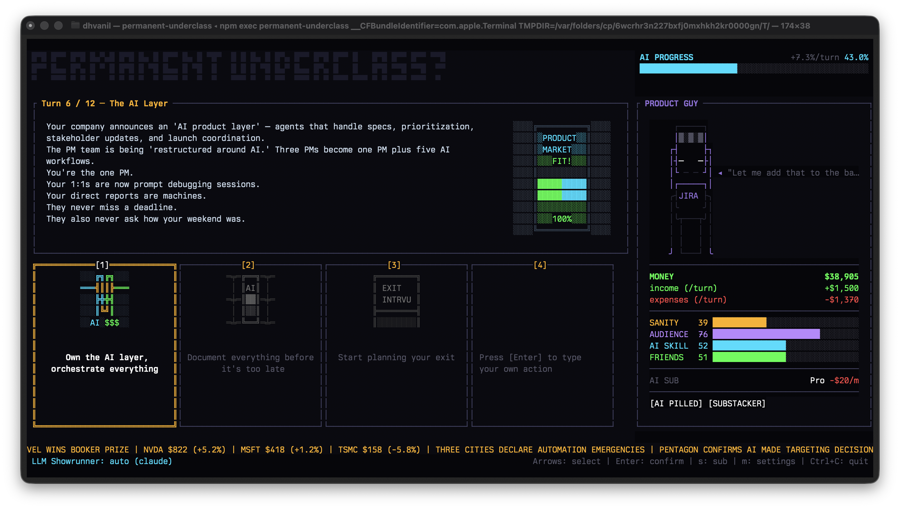
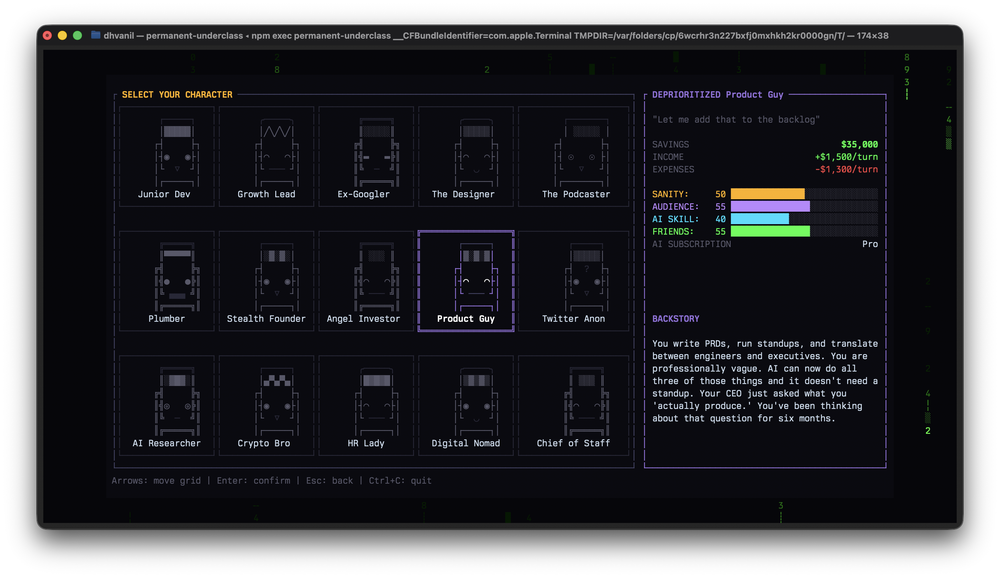

# Permanent Underclass

Terminal game about surviving AI acceleration.

```bash
npx --yes permanent-underclass@latest
```

## What This Is

You pick a character, live through a collapsing job market, and try to make it to an ending without going broke or burning out.

- Short, replayable runs (`simple`: 12 turns, `standard`: 32 turns)
- Character-specific event pools with different pressure profiles
- No single correct path; tradeoffs are the point
- Endings built for screenshots and sharing

## Why It Feels Different

You are not locked to the three presented choices.

Press `4` and type your own move:

- `start a podcast`
- `cry in the bathroom`
- `go on a meditation retreat`
- `short nvidia`

With LLM mode enabled, your local `codex` or `claude` CLI resolves that action into real in-game consequences.

## Screenshots

Title screen:



Character select:


Live turn UI:



## Play

```bash
# stable
npx --yes permanent-underclass@latest

# beta
npx --yes permanent-underclass@beta
```

## Local Quick Start

```bash
cargo run
```

CLI help:

```bash
cargo run -- --help
```

## Controls

- `Ctrl+C`: quit
- `Enter`: confirm / continue
- Arrow keys: navigate cards, menus, settings
- `1` / `2` / `3`: choose a card
- `4`: enter freeform mode (`Enter` submit, `Esc` cancel)
- `s`: manage subscription (`Free` / `Pro` / `Ultra` / `Giga`)
- `m`: open in-run settings
- `Esc`: back/cancel

## Tempo Modes

- `simple`: 12 turns (default)
- `standard`: 32 turns

Use `--tempo simple|standard` in `--cli`, `--headless`, and `--llm-bench` modes.

## LLM Mode (Optional)

```bash
# auto provider (default): prefers Claude if installed, else Codex
cargo run -- --llm

# Codex
codex login
cargo run -- --llm --llm-provider codex

# Claude
claude auth
cargo run -- --llm --llm-provider claude
```

Optional flags: `--llm-model`, `--llm-reasoning low|medium|high|xhigh`, `--llm-profile`.

<details>
<summary>Advanced Local Modes</summary>

### CLI Interactive (No TUI)

```bash
cargo run -- --cli --character junior-dev --seed 1
cargo run -- --cli --character junior-dev --seed 1 --tempo standard
```

### Headless Autoplay

```bash
cargo run -- --headless --character junior-dev --seed 1
cargo run -- --headless --character junior-dev --seed 1 --tempo standard
```

### Headless With LLM + Snapshot Save/Resume

```bash
cargo run -- --headless --llm --save-file run.snapshot.json --character junior-dev --seed 1
cargo run -- --headless --llm --resume-file run.snapshot.json
```

### LLM Benchmark (No TUI)

```bash
cargo run -- --llm-bench --llm-provider auto --llm-bench-iters 1
cargo run -- --llm-bench --llm-provider auto --llm-bench-iters 1 --tempo standard
```

### Balance Simulation

```bash
cargo run --bin balance_sim -- --seeds 20
cargo run --bin balance_sim -- --seeds 400 --character all --tempo standard --output-jsonl data/sim/ending_sweep_latest.jsonl
```

</details>

## Command Center

```bash
npm run dev
```

Opens `http://localhost:5173/command-center` to browse events, endings, characters, flags, and sprites.
If `data/sim/ending_sweep_latest.jsonl` exists, the `Sim` tab renders ending/policy/character outcome summaries.
Source lives in `apps/command-center/`.

## Tests and Security Checks

```bash
# full release gate (single pass/fail summary)
./scripts/release_preflight.sh

# individual checks
cargo test --lib
cargo test --test sim
# one-time: cargo install cargo-audit
cargo audit
# one-time: cargo install cargo-deny
cargo deny check advisories
# one-time: brew install gitleaks  # or install from https://github.com/gitleaks/gitleaks
gitleaks detect --source . --no-git --redact --exit-code 1
```

## Licensing

- Code license: `LICENSE` (MIT)
- Non-code asset licensing and attribution status: `ASSET_LICENSES.md`
